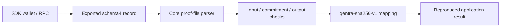

# Qentra Protocol

Quantum randomness infrastructure for onchain applications. Unpredictable by nature. Verifiable onchain.

`@qentra/core` provides shared protocol-proof verification, reproducible application mappings and request-record persistence. Export a fulfilled tournament draw through the SDK; recipients can check its saved result through core alone, without connecting a wallet, contacting RPC or paying again.

```js
import { parseProofFile, verifyProofFile } from '@qentra/core';
const draw = await parseProofFile(savedProofJson);
const checked = await verifyProofFile(draw);
console.log(checked.mapping.result);
```

## Developer surfaces

- Schema4 `ProtocolRecord` / `ProtocolInput`, `verifyProtocolRecord`, and proof-file parse/export/verify APIs.
- Unchanged `qentra-sha256-v1` uniform integers, shuffle, weighted choice and unique winners.
- Schema1 `RequestRecord`, `validateRecord`, `MemoryRepository` and `IndexedDBRepository` for existing browser adapters.
- [Portable proof module guide](docs/PROTOCOL_PROOFS.md), [record/mapping reference](docs/CORE.md), [source boundary](docs/SOURCE.md).
- [Installed saved-proof example](examples/verify-proof.mjs), JSON schemas and meaningful recomputation/tamper tests.
- [SDK](https://github.com/qentra-protocol/sdk) for wallet/RPC integration and [developer guides](https://github.com/qentra-protocol/docs).



## Source development

Use Node22+, `npm install`, then `npm run check` to typecheck, run tests/examples and build ESM/declarations. `npm pack --ignore-scripts` creates a local development archive after the build. Install that tarball in a separate application; `node node_modules/@qentra/core/examples/verify-proof.mjs draw-proof.json` checks a saved draw. The package remains private and uses development version `0.2.0-dev.0`.

Core has no wallet or RPC transport. Offline recomputation checks content integrity; SDK source/payment checks provide their distinct provenance paths. The schema1 and schema4 APIs coexist, with identical historical mapping outputs.

## Installation

[Build from source or install matching release tarballs](docs/INSTALL.md). Releases include checksum verification and both package versions; availability follows the repository release list.
